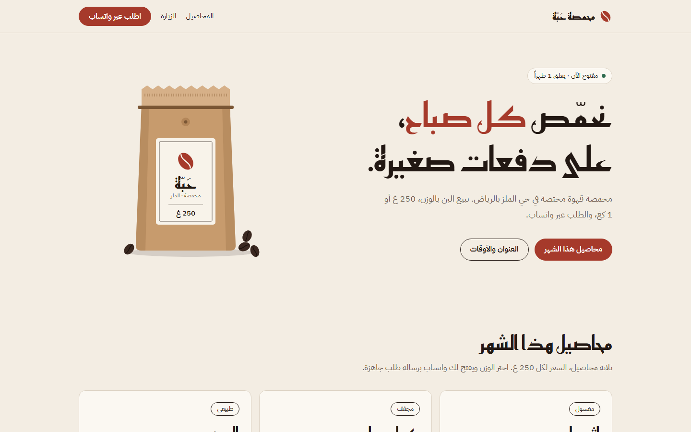
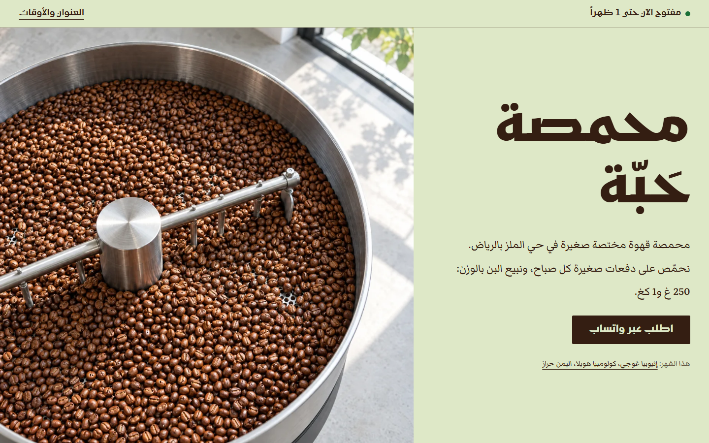

<div align="center">

# tasmeem · تصميم

**Design that reads as made, not generated. Arabic first, then Persian and English.**

An agent skill for Claude Code, Codex, Cursor and any agent that reads `SKILL.md`.<br>
It builds, audits, critiques and polishes interfaces, checks its own work before handing it over,<br>
and fills image slots with real assets instead of gradients.

```text
/plugin marketplace add Ekka-Barber/tasmeem
```

[](https://github.com/Ekka-Barber/tasmeem/actions/workflows/test.yml)
[](CHANGELOG.md)
[](LICENSE)
[](https://github.com/Ekka-Barber/tasmeem/commits/main)
[](https://github.com/Ekka-Barber/tasmeem/stargazers)


[العربية](README.ar.md) · [Quick start](#quick-start) · [Modes](#modes) · [The scanner](#the-scanner) · [The gate](#the-gate) · [Languages](#arabic-persian-english) · [Real assets](#real-assets-with-higgsfield) · [FAQ](#faq) · [Changelog](CHANGELOG.md)

</div>

---

## Before and after

The same brief, run twice in fresh headless Claude Code sessions: a one-page site for a small Riyadh roastery, with every fact supplied in the brief. One run had no skills; the other had tasmeem. Nothing was touched up afterwards.

<table>
<tr><th width="50%">Without skills</th><th width="50%">With tasmeem</th></tr>
<tr>
<td></td>
<td></td>
</tr>
</table>

| | Without skills | With tasmeem |
|---|---|---|
| Direction | cream ground, one headline phrase in red, a pill badge, three identical cards | green-coffee ground with roast-brown ink (the two states of the bean), an asymmetric split, prices set as a menu |
| Images | a hand-drawn SVG bag | two comp mockups, then a generated photograph of a cooling tray and a transparent green-bean cutout, each with its provenance file |
| Facts | as supplied | as supplied; the missing ones (a price per kilo) listed, not invented |
| Measured by tasmeem (P0 · P1 · P2) | 2 · 9 · 1 | 0 · 8 · 0 |
| Time, credits | 7 min | 18 min, 6.5 Higgsfield credits |

The eight P1 findings in the tasmeem run are one real defect: the display face Kufam was set at label size, where the dot of a final ن disappears, so «العنوان» reads «العنوار». The eval exposed a gap in the rulebook, and TY-24 now catches it. The runs are reproducible with [`evals/run.mjs`](evals/run.mjs); results are in [`evals/results.md`](evals/results.md). This is one brief, not a benchmark.

## Quick start

<details open>
<summary><b>Claude Code</b> (plugin)</summary>

```text
/plugin marketplace add Ekka-Barber/tasmeem
/plugin install tasmeem@tasmeem
```
</details>

<details>
<summary><b>Codex, Cursor, Gemini CLI and other agents</b> (skills CLI)</summary>

```bash
npx skills add Ekka-Barber/tasmeem
```
</details>

<details>
<summary><b>Manual</b></summary>

Copy `skills/tasmeem` into `~/.claude/skills/` (or your agent's skills folder). Nothing to build.
</details>

<details>
<summary><b>Optional extras</b>: a real browser for checks, and image generation</summary>

```bash
npm i -D playwright && npx playwright install chromium   # real-browser checks (render)
npm i -g @higgsfield/cli && higgsfield auth login        # image assets (uses your Higgsfield credits)
```
</details>

Then talk to your agent as usual. tasmeem picks the mode from what you ask:

```text
Design the landing page for a Riyadh specialty roastery, in Arabic.
tasmeem audit src/app
Critique the booking flow as a first-time visitor on a phone.
Harden the checkout: empty states, errors, long names, slow network.
صمّم صفحة حجز لصالون حلاقة في الرياض
راجع واجهة التطبيق وقل لي ما الذي يبدو مصنوعاً بالذكاء الاصطناعي
```

## Why

Ask a model for a landing page and you get the same page every time: a purple-to-blue gradient, a centred headline with one word in another colour, a pill badge, three identical icon cards, and a fade-up on everything. Ask for "something tasteful" and you get the second default: cream, a serif and terracotta.

Ask for it in Arabic and it gets worse. Letter-spacing tears the joined letters apart, the browser fakes italics on a script that has none, line heights clip the marks, arrows point the wrong way, and the fonts fall back to whatever the system has.

tasmeem fixes this at the source. It decides a direction before it draws, sets type for the script actually on the page, fills image slots with authored assets, and runs a measured gate before anything ships.

## What it does

| | |
|---|---|
| **Direction before pixels** | A design read, the surface type (persuade, operate, read, experience), a scene sentence, the subject's own world, three dials, a colour strategy, one signature element, then a check for first- and second-order reflexes, with the rut named and left on purpose. |
| **198 tells, one rulebook** | The patterns that a dozen independent design skills and guides agree make an interface look generated, merged and rewritten, with their conflicts resolved once. Each tell has a severity, a fix and the conditions under which it is allowed. |
| **Evidence, not vibes** | A zero-dependency scanner reports 126 of those tells with file and line. An optional real-browser check reads computed styles: contrast on the actual background, the fonts actually drawn, overflow, held animations. |
| **A gate that blocks the right things** | Three tiers (Floor, Reflex, Finish), a click-through of every control, and a fresh-eyes review by an agent that did not see the build. |
| **Arabic first** | Arabic type, direction, digits, plurals, calendars, bidi, forms, voice and copy; direction-aware JavaScript; Persian (ی and ک, ZWNJ, Persian digits, the Solar Hijri calendar); English, and pairing it with Arabic-script faces. |
| **The platform before a library** | A support table for the native features of late 2026 (anchor positioning, popovers, `@starting-style`, scroll-driven animation, View Transitions, `contrast-color()`…), each with its fallback. |
| **Real assets** | With Higgsfield, tasmeem works the way a studio does: mockup → region map → generated plates → code that matches the mockup. Every generation has a cost gate and a provenance file. |
| **Brand wins over taste** | A brand's documented choices override the taste rules and are reported as exceptions. Nothing overrides contrast, focus, `lang` and `dir`, honesty or script correctness. |

## Modes

| Mode | What happens |
|---|---|
| **build** | direction → first screen built and reviewed alone → optional comp and assets → the rest → gate |
| **audit** | measure (scan, built, render) → judge → one numbered report with a score out of 20; nothing is edited until you pick |
| **critique** | ten heuristics scored 0–4, a cognitive-load checklist, personas; ship, fix, rebuild or recapture |
| **polish** | fix the measured P0 and P1 findings plus the details, inside your existing system |
| **bolder · quieter · distill** | raise one dial, remove decoration, or cut what has no job, inside the identity |
| **harden** | every state, every empty state, content extremes, network errors, input in both digit systems |
| **adapt** | touch and pointer, the thumb zone, the middle widths, print and email |
| **redesign** | keep the content, routes and brand; change the structure; `kept` proves nothing was dropped |
| **study** | extract the structure, type, colour and rhythm of a design you admire, never its pixels |
| **brand** | positioning, palette, type per script, marks, materials, imagery, motion, voice → `DESIGN.md` |
| **assets** | comp, region map, plates through Higgsfield or /rasm, provenance |
| **motion** | measure, then design the tokens and one orchestrated moment per view |
| **copy** | interface words in every language present, without touching the owner's own text |
| **document** | write `DESIGN.md` (in the open [DESIGN.md](https://github.com/google-labs-code/design.md) token format) or `PRODUCT.md` |

## The scanner

`skills/tasmeem/scripts/tasmeem.mjs` runs on Node 18+ with no dependencies:

```bash
node skills/tasmeem/scripts/tasmeem.mjs scan src/                    # CSS, JSX/TSX, HTML, Vue, Svelte, Astro
node skills/tasmeem/scripts/tasmeem.mjs built out/                   # built HTML, local stylesheets inlined
node skills/tasmeem/scripts/tasmeem.mjs render http://localhost:3000 --motion   # real browser (Playwright)
node skills/tasmeem/scripts/tasmeem.mjs kept old/src src             # redesign: links, fields, headings dropped?
node skills/tasmeem/scripts/tasmeem.mjs scan src --github            # annotations on a pull request
node skills/tasmeem/scripts/tasmeem.mjs report .tasmeem/*.json --design DESIGN.md --out audit.md
```

Real output on the Arabic fixture in `tests/fixtures/` (abridged):

```text
tests/fixtures/arabic-slop.html
  P0  SC-01  L11    letter-spacing 0.05em set on Arabic  · :lang(ar) p
  P0  SC-03  L11    Arabic line-height 1.3 (floor 1.6 for body)  · :lang(ar) p
  P1  CP-03  L16    "ليست مجرد"  · قهوتنا ليست مجرد مشروب، بل أسلوب حياة
  P1  CP-10  L18    right-pointing arrow in Arabic text (forward is ←)
  P1  CP-15  L18    "قم بالنقر"  · … قم بالنقر هنا
  P1  SC-05  L2     RTL language without dir="rtl" on <html>
  P1  SC-07  L19    Western and Arabic-Indic digits in one string
  P2  SC-16  L20    tatweel used for stretching  · عـــرض خـــاص

P0 3 · P1 14 · P2 4
```

And when a file is the template rather than a few choices:

```text
  P1  SY-10   template stack: 20 different taste tells in one file (CM-03 CM-04 CM-13 CO-01 CO-02 CO-05 …).
              Rework the structure, not the items one by one
```

A brand's own choices go in `DESIGN.md` under **Brand exceptions** (`CO-03: the sand ground is the brand colour`), or inline with `/* tasmeem-allow CO-03 reason */`. The report lists them separately and never lets them excuse an accessibility, honesty or script failure.

| Category | Tells | Examples |
|---|---|---|
| Colour `CO` | 18 | purple-to-blue gradient, unchosen indigo, cream by default, gradient text, glow, the opacity ladder |
| Type `TY` | 25 | Inter for everything, the tasteful-font cluster, italic display, the accented headline word, eyebrows, display faces at text size |
| Layout `LA` | 26 | the centred hero, three icon cards, the stat strip, 01/02/03 scaffolding, overflow, two-state layouts |
| Components `CM` | 24 | kit defaults, glass by reflex, side stripes, icon chips, redrawn chrome, dead controls, the default dashboard shell |
| Motion `MO` | 21 | one fade-up for everything, bounce, `transition: all`, animated layout, reduced motion as a kill switch |
| Copy `CP` | 19 | buzzwords in three languages, "not X but Y", invented metrics, placeholders, translation-shaped Arabic, chatbot residue |
| Imagery `IG` | 14 | stock people, the generated-illustration look, placeholders, drawn stand-ins, garbled text in generated images |
| System `SY` | 10 | design-system drift, sameness, a famous product's skin, the template stack |
| Quality `QA` | 19 | contrast, focus, headings, `lang`, targets, zoom, forms, mouse-only gestures, inputs under 16 px |
| Scripts `SC` | 22 | tracked Arabic, fake italics, line-height floors, fallback glyphs, physical CSS in RTL, ligatures off, direction-blind code |

## The gate

Every delivery ends with the gate in [`core/gate.md`](skills/tasmeem/references/core/gate.md):

| Tier | What | Effect |
|---|---|---|
| **Floor** | P0s, accessibility, honesty, dead controls, script correctness | blocks delivery; no brand exception covers it |
| **Reflex** | the other P1 taste tells | fixed, or kept on the record with the reason that allows it |
| **Finish** | P2 polish | listed; never blocks |

It measures, captures 390 and 1440 px (plus 360 for overflow), clicks every control, asks an agent that did not see the build for a disposition, fixes once, measures once more, and stops. In Claude Code it can also run after every edit:

```json
{ "hooks": { "PostToolUse": [{ "matcher": "Edit|Write|MultiEdit",
  "hooks": [{ "type": "command", "command": "node <skill>/scripts/tasmeem.mjs scan --hook" }] }] } }
```

## Arabic, Persian, English

| Language | What tasmeem knows |
|---|---|
| **Arabic** | Naskh, Kufi, Ruqaa and display roles; families, their axes and Latin partners; size balancing with per-script `size-adjust`; line heights (and Tailwind's `leading-*`); never tracking, italics, case or disabled ligatures; display faces kept large; «، ؛ ؟»; the digit policy and digit-safe inputs; six plural forms by n mod 100; Hijri and Gregorian; the week start per country (Sunday in Saudi Arabia); three-decimal currencies; the new riyal sign U+20C1 and how to render it; the Saudi national address; bidi islands; direction-aware JavaScript and Radix/shadcn; the "Arabic costume" reflex |
| **Persian** | ی and ک (never ي and ك), ZWNJ in compounds, Extended Arabic-Indic digits and separators, the Solar Hijri calendar, Nastaliq kept to display and poetry, Persian machine-copy tells |
| **English** | coverage, case and hyphenation with `lang`, tracking limits, measure, curly punctuation, sentence case, and matching the Latin partner to an Arabic or Persian face |

## Real assets with Higgsfield

Leaving image slots to gradients and glass is the fastest way to look generated. tasmeem's asset mode:
- **Comp:** a full-page mockup that carries the composition, never the copy.
- **Region map:** each region marked as painted or coded.
- **Plates:** each painted region generated as its own asset: photographs, textures, transparent cutouts, vector icon sets in your palette.
- **Build:** code that matches the mockup. Every word, control and state stays live HTML.

```bash
node skills/tasmeem/scripts/tasmeem.mjs higgs doctor
node skills/tasmeem/scripts/tasmeem.mjs higgs cost --model gpt_image_2_5 --prompt-file hero.txt --aspect 16:9 --resolution 2k --quality high
node skills/tasmeem/scripts/tasmeem.mjs higgs gen  --model gpt_image_2_5 --prompt-file hero.txt --aspect 16:9 --resolution 2k \
     --quality high --ref .tasmeem/crops/hero.png --out public/plates/hero.png --budget 10
```

- **The cost gate:** `gen` refuses to spend without `--budget` or `--yes`, and refuses when the estimate exceeds the budget.
- **Provenance:** every result gets a `.json` sidecar with the model, parameters, prompt, references and job id.
- **Text in images is never trusted.** Generated Arabic lettering breaks, so text is set in code.
- **Without Higgsfield,** tasmeem works code-led and writes art-direction briefs for your own media.
- **Companions:** [/rasm](https://github.com/Ekka-Barber/higgsfield-prompt-master) for Arabic-first prompts, and Higgsfield's [official skills](https://github.com/higgsfield-ai/skills) for generation.

## How it is built

```
skills/tasmeem/
├─ SKILL.md                 router: setup, non-negotiables, routes, the tells to keep in mind (under 100 lines)
├─ references/
│  ├─ core/                 direction · honesty · the delivery gate
│  ├─ tells/                198 tells in 10 categories: severity, fix, allowed-when, sources
│  ├─ scripts-lang/         Arabic, Persian, English, bidi, numerals and dates, punctuation
│  ├─ craft/                type · colour · layout · components · forms · a11y and performance · the platform in 2026
│  ├─ motion/               principles · techniques · produced video
│  ├─ brand/                identity
│  ├─ assets/               pipeline · Higgsfield · /rasm · prompts · provenance
│  └─ modes/                build · audit · critique · the other modes
├─ scripts/tasmeem.mjs      scan · built · render · kept · contrast · tokens · palette · report · higgs · context
└─ templates/               DESIGN.md (open token format) · PRODUCT.md
```

The agent reads `SKILL.md`, then only the references the task needs.

## FAQ

<details>
<summary><b>Will it make every site look the same, just in a different style?</b></summary>

That is the failure it is built against. The direction step names the obvious plan and its predictable opposite, and asks for candidates from the subject's own world. `DESIGN.md` can record the directions already used for an owner, so the next project does not repeat them. SY-10 flags a file that stacks six or more tells, which is the template whatever its colours.
</details>

<details>
<summary><b>Does it work for English-only projects?</b></summary>

Yes. The script rules switch on only when Arabic or Persian text is present; everything else applies to any page.
</details>

<details>
<summary><b>Can I use it with impeccable, taste-skill or Hallmark?</b></summary>

Use one design skill per task. Their rules conflict in places, and tasmeem's catalog already merges them with the conflicts resolved. Remotion's skills (video) and /rasm or Higgsfield's skills (images) work well beside it.
</details>

<details>
<summary><b>Does it spend money?</b></summary>

Only the asset mode, and only through `higgs gen`, which refuses to run without an explicit budget. Everything else is local.
</details>

<details>
<summary><b>My brand really is cream and serif.</b></summary>

Then write it in `DESIGN.md` under Brand exceptions. tasmeem reports it as an exception with that line, not as a finding.
</details>

## Tests and contributing

```bash
npm test      # node:test: 24 tests over fixtures (AI slop, Arabic slop, Persian copy, Tailwind, a clean Arabic page)
```

New tells, phrase lists and fixes are welcome; see [CONTRIBUTING.md](CONTRIBUTING.md). Every detector needs a fixture that triggers it and one that does not.

## Credits

tasmeem learned from [impeccable](https://github.com/pbakaus/impeccable), [Hallmark](https://github.com/Nutlope/hallmark), [Gesso anti-slop](https://github.com/Gesso-Build/skills), [avoid-ai-design](https://github.com/funboy322/avoid-ai-design), [antislop](https://github.com/miqdadbadjuber/anti-slop), [taste-skill](https://github.com/Leonxlnx/taste-skill), [Anthropic's frontend-design](https://github.com/anthropics/skills), [Emil Kowalski](https://github.com/emilkowalski/skills), [make-interfaces-feel-better](https://github.com/jakubkrehel/make-interfaces-feel-better), [Vercel's Web Interface Guidelines](https://github.com/vercel-labs/web-interface-guidelines), [ui-skills](https://github.com/ibelick/ui-skills), [designing-arabic-frontends](https://github.com/ahmed-badawood/designing-arabic-frontends), [DESIGN.md](https://github.com/google-labs-code/design.md), [visant-skills](https://github.com/pedrojaques99/visant-skills-public), the [W3C Arabic and Persian layout requirements](https://www.w3.org/TR/alreq/) and more. Every rule is restated in tasmeem's own words; see [CREDITS.md](CREDITS.md) and [NOTICE](NOTICE).

<div align="center">

<a href="https://star-history.com/#Ekka-Barber/tasmeem&Date"></a>

MIT © 2026 Majed (Ekka Barber)

</div>
